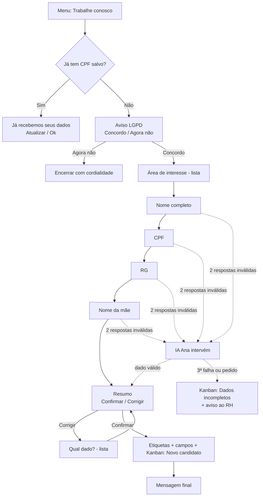

# Fluxos BotConversa – Perboni FLV

Especificação dos fluxos de atendimento no WhatsApp (BotConversa), com foco no
fluxo **Trabalhe Conosco**, que coleta os 4 dados dos candidatos e os coloca no
Kanban (CRM) para análise.

**Princípios**
- Tudo que puder ser clicado vira botão ou lista. A pessoa só digita os próprios dados.
- Cada mensagem tem uma única pergunta.
- A IA (Ana) entra só quando o fluxo trava. Depois disso, a conversa volta para o fluxo.
- Toda resposta digitada também é aceita por número ("1", "2"...), para quem não vê botões.

> Limites do WhatsApp: **até 3 botões** por mensagem. Com mais de 3 opções, use **lista** (até 10 itens).

---

## 1. Menu principal (lista)

```
Olá 👋 Eu sou a Ana, da Perboni FLV.
Como posso te ajudar hoje?
[ Ver opções ]  ← botão que abre a lista
```

| # | Item da lista | Descrição curta | Vai para |
|---|---|---|---|
| 1 | 📦 Atacado | Compras em caixa fechada | Fluxo Atacado |
| 2 | 🎁 Cestas Perboni | Ouro e Diamante – Grande Goiânia | Fluxo Cestas (IA) |
| 3 | 💳 Financeiro | Boleto, crédito, pagamentos | Fluxo Financeiro |
| 4 | 🚚 Quero ser fornecedor | Venda para a Perboni | Fluxo Fornecedor |
| 5 | 🤝 Trabalhe conosco | Envie seus dados para as vagas | **Fluxo Trabalhe Conosco** |
| 6 | 💡 Sugestões e melhorias | Sua opinião | Fluxo Sugestões |
| 7 | 👤 Falar com atendente | Atendimento humano | Transferência humana |
| 8 | ❓ Outros assuntos | Outras dúvidas | IA (Ana) |

Se a pessoa digitar algo em vez de escolher: a IA interpreta a intenção e
leva para o fluxo certo (ex.: "tem vaga?" → item 5).

---

## 2. Fluxo Trabalhe Conosco (novo)

### Visão geral



### Campos personalizados (criar no BotConversa)

| Campo | Tipo | Observação |
|---|---|---|
| `cand_area` | Texto | Área escolhida na lista |
| `cand_nome` | Texto | Nome completo |
| `cand_cpf` | Texto | Só números (11 dígitos). Use texto, e não número, para não perder zeros à esquerda |
| `cand_rg` | Texto | Como o candidato digitou |
| `cand_nome_mae` | Texto | Nome completo da mãe ou "NÃO CONSTA" |
| `cand_status` | Texto | `novo`, `incompleto`, `em_analise`... |
| `cand_data_envio` | Data | Data da confirmação |
| `cand_lgpd_ok` | Texto | `sim` + data do aceite |
| `cand_tentativas` | Número | Contador de respostas inválidas (zerar a cada pergunta) |

### Passo a passo

**Passo 0 – Checagem de duplicidade (Condição)**
Se `cand_cpf` já estiver preenchido:
```
Oi, {primeiro_nome}! Já recebemos seus dados para o processo seletivo 😊
[ Atualizar meus dados ]  [ Tudo certo, obrigado ]
```
- Atualizar: vai para o Passo 7 (Corrigir).
- Tudo certo: encerra.

**Passo 1 – Boas-vindas e consentimento (LGPD)**
```
Que bom que você quer fazer parte do time Perboni! 🍊

Para participar do processo seletivo, vamos pedir 4 dados:
• Nome completo
• CPF
• RG
• Nome da mãe

Eles servem só para a análise do processo seletivo e ficam
restritos ao nosso RH.

Podemos continuar?
[ ✅ Sim, concordo ]  [ ❌ Agora não ]
```
- Sim: salva `cand_lgpd_ok = sim – {data}`.
- Agora não: "Tudo bem! Quando quiser, é só voltar aqui e escolher *Trabalhe conosco*." Encerra.

**Passo 2 – Área de interesse (lista)** *(5º dado opcional, serve para categorizar)*
```
Em qual área você gostaria de trabalhar?
[ Ver áreas ]
```
Lista: Operação/Galpão (separação, carga e descarga) · Motorista/Entregas ·
Administrativo · Comercial/Vendas · Qualquer área.
Salva em `cand_area` e aplica a etiqueta `area-<nome>`.
> Ajuste a lista conforme as vagas abertas. Se não quiser essa etapa, remova o passo; o restante do fluxo não muda.

**Passo 3 – Nome completo (Pergunta → `cand_nome`)**
```
Qual é o seu nome completo? ✍️
(igual ao documento)
```
Validação: pelo menos 2 palavras e nenhum número.
Inválido: "Pode me mandar o nome completo, com sobrenome? 🙂"

**Passo 4 – CPF (Pergunta → `cand_cpf`)**
```
Agora, seu CPF (só os números):
```
Validação: depois de tirar pontos, traços e espaços, deve ter **11 dígitos**.
Inválido: "O CPF tem 11 números. Pode conferir e mandar de novo?"
> O BotConversa não confere o dígito verificador. Para validar de verdade, use um bloco de Integração (webhook) ou deixe a IA conferir (ver seção 3).

**Passo 5 – RG (Pergunta → `cand_rg`)**
```
Qual é o número do seu RG?
```
Validação: pelo menos 5 caracteres e ao menos 1 número. Não force um formato, porque cada estado tem o seu.

**Passo 6 – Nome da mãe (Pergunta → `cand_nome_mae`)**
```
Por último: qual é o nome completo da sua mãe?
(como está no seu documento)
[ Não consta no documento ]
```
- Botão: salva `NÃO CONSTA`.
- Validação do texto: pelo menos 2 palavras.

**Passo 7 – Confirmação**
```
Confere se está tudo certo:

👤 Nome: {cand_nome}
🪪 CPF: {cand_cpf}
🪪 RG: {cand_rg}
👩 Mãe: {cand_nome_mae}
💼 Área: {cand_area}

[ ✅ Está tudo certo ]  [ ✏️ Corrigir ]
```
Corrigir → lista: Nome · CPF · RG · Nome da mãe · Área → volta para a
pergunta escolhida → retorna ao resumo.

**Passo 8 – Ações (bloco Ação, sem mensagem)**
1. Etiquetas: `candidato`, `area-<nome>`.
2. Campos: `cand_status = novo`, `cand_data_envio = hoje`.
3. **CRM/Kanban**: adicionar o contato ao funil **Recrutamento**, etapa **Novo candidato**.
4. Notificar o RH (Sandra) com o resumo, por notificação interna do BotConversa ou por mensagem de WhatsApp para o número do RH.
5. *(Opcional)* Integração/webhook enviando os campos para uma planilha (Google Sheets), para quem faz as análises trabalhar em lote.

**Passo 9 – Mensagem final**
```
Pronto, {primeiro_nome}! Seus dados foram enviados ao RH da Perboni ✅

Se o seu perfil seguir no processo, entraremos em contato
por este número. Obrigado pelo interesse! 🍊
```
> Não prometer vaga, prazo nem retorno garantido (regra da Ana).

### Kanban – funil "Recrutamento"

| Etapa | Quem move | Quando |
|---|---|---|
| **Novo candidato** | Bot | Dados confirmados |
| **Dados incompletos** | Bot | A IA não conseguiu concluir ou a pessoa pediu humano |
| **Em análise** | RH | Nome enviado para a análise (antecedentes/consulta) |
| **Aprovado na análise** | RH | Análise ok |
| **Entrevista agendada** | RH | — |
| **Contratado** | RH | — |
| **Não seguiu / Banco de talentos** | RH | Reprovado ou sem vaga no momento |

Título do card: **nome + área** (ex.: "Maria Souza – Operação").
**Não coloque CPF/RG no título do card.** Esses dados ficam só nos campos do contato.

---

## 3. Quando a IA (Ana) intervém

A IA entra **só** nestes gatilhos:

| Gatilho | O que a IA faz |
|---|---|
| 2 respostas inválidas na mesma pergunta | Explica com outras palavras e pede de novo **só aquele dado** |
| A pessoa digita texto em vez de clicar o botão | Interpreta ("sim", "pode", "bora" = concordo) e segue o fluxo |
| Pergunta no meio do fluxo ("qual o salário?", "tem vaga de motorista?", "onde fica?") | Responde o que está na base. Se não estiver, diz que o RH informa nessa etapa. Depois retoma a pergunta pendente |
| Manda foto do documento ou áudio | Pede educadamente que digite o dado (o bot não lê imagem de documento) |
| Manda vários dados numa mensagem só ("Maria Souza, cpf 123...") | Separa e salva cada dado no campo certo, depois vai direto ao resumo (Passo 7) |
| 3ª falha, irritação ou pedido de falar com pessoa | Move no Kanban para **Dados incompletos**, avisa o RH e encerra com cordialidade |

Configuração no BotConversa: nas perguntas, o caminho de "resposta inválida"
incrementa `cand_tentativas`. Uma Condição `cand_tentativas >= 2` leva ao bloco
de IA com o prompt da seção "FLUXO – TRABALHE CONOSCO" do arquivo
`ANA_IA_PERBONI.txt`. A IA devolve o dado limpo e o fluxo segue.

---

## 4. Demais fluxos (com botões)

**Atacado**
1. "Qual produto você procura?" (texto livre; a IA confere na base se a Perboni trabalha com o item)
2. "Quantidade aproximada?" → botões: `[ Até 10 caixas ] [ 10 a 50 ] [ Mais de 50 ]`
3. "Qual sua cidade?" (texto)
4. Envia os contatos do comercial (Wagna / Gil). Etiqueta `lead-atacado`. Kanban: funil **Comercial**, etapa **Novo lead**.

**Cestas**
1. "Você está na Grande Goiânia?" → `[ Sim ] [ Não ]`
   - Não: "No momento, as cestas são entregues apenas na Grande Goiânia." Encerra.
2. "Qual cesta você quer conhecer?" → `[ 🥇 Ouro ] [ 💎 Diamante ] [ Ver as duas ]`
3. A IA apresenta a composição literal do arquivo `CESTAS_PERBONI_FLV`, depois o preço.
4. "Quer finalizar?" → `[ Sim, quero ] [ Só estava olhando ]`. Sim: transferência humana interna.

**Financeiro**: `[ Boleto / 2ª via ] [ Crédito a prazo ] [ Outro ]` → contato da Mira.

**Fornecedor**: "Qual produto você fornece?" (texto) + cidade → contato do Ricardo. Etiqueta `fornecedor`.

**Sugestões**: texto livre → agradece → etiqueta `sugestao` → notifica o marketing.

**Reclamação** (detectada pela IA em qualquer ponto): `[ Comprei no supermercado ] [ Comprei direto com a Perboni ]` → contato da Wagna.

**Fim de todo fluxo**: `[ Voltar ao menu ] [ Encerrar ]`

---

## 5. LGPD – cuidados com CPF, RG e nome da mãe

- O aceite do Passo 1 fica registrado em `cand_lgpd_ok`.
- Só o RH deve ter acesso aos campos `cand_*`. Revise as permissões dos atendentes no BotConversa.
- Não exporte esses dados para grupos de WhatsApp. Envie para as análises por um canal restrito.
- Defina um prazo para apagar os dados de quem não seguiu (sugestão: 6 meses).
