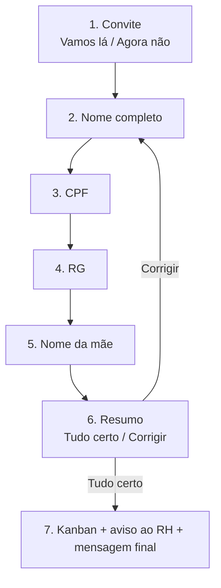

# Fluxos BotConversa – Perboni FLV (versão simples)

Regra geral: **a pessoa clica em botões. Só digita os próprios dados.**
Se ela travar, a IA (Ana) ajuda.

---

## Fluxo "Trabalhe conosco" – 7 blocos



**Bloco 1 – Convite** (mensagem com 2 botões)
```
Que bom que você quer trabalhar na Perboni! 🍊
Vou pedir 4 dados: nome completo, CPF, RG e nome da mãe.
Eles são usados só no processo seletivo.

[ Vamos lá ]  [ Agora não ]
```
"Agora não" → "Tudo bem! Quando quiser, é só voltar aqui." e encerra.

**Bloco 2 – Pergunta:** "Qual é o seu nome completo?" → salva em `nome_completo`

**Bloco 3 – Pergunta:** "Qual é o seu CPF? (só números)" → salva em `cpf`

**Bloco 4 – Pergunta:** "Qual é o número do seu RG?" → salva em `rg`

**Bloco 5 – Pergunta:** "Qual é o nome completo da sua mãe?" → salva em `nome_mae`

**Bloco 6 – Resumo** (mensagem com 2 botões)
```
Confere se está certo:
Nome: {nome_completo}
CPF: {cpf}
RG: {rg}
Mãe: {nome_mae}

[ Tudo certo ]  [ Corrigir ]
```
"Corrigir" → volta ao Bloco 2 e pergunta tudo de novo.

**Bloco 7 – Ação + mensagem final**
- Ação: adicionar a etiqueta `candidato`
- Ação: colocar no Kanban **Recrutamento → Novo candidato**
- Ação: notificar o RH (Sandra)
- Mensagem:
```
Pronto! Seus dados foram enviados ao RH ✅
Se seu perfil seguir no processo, entraremos em contato por aqui.
```

---

## Kanban "Recrutamento" – 4 colunas

| Novo candidato | Em análise | Aprovado | Não aprovado |
|---|---|---|---|
| o bot coloca aqui | o RH arrasta ao mandar o nome para análise | o RH arrasta | o RH arrasta |

---

## Quando a IA entra

Só em uma situação: **a resposta não fez sentido** (ex.: CPF sem 11 números,
nome sem sobrenome, foto, áudio ou pergunta no meio do caminho).

No BotConversa: em cada pergunta, ligue a saída "resposta inválida" ao bloco de IA.
A IA pede o dado de novo de um jeito simples e devolve a pessoa ao fluxo.
Se mesmo assim não der certo, ela passa o contato do RH.

---

## Menu principal – lista

```
Olá 👋 Eu sou a Ana, da Perboni FLV. Como posso ajudar?
[ Ver opções ]
```
📦 Atacado · 🎁 Cestas · 💳 Financeiro · 🚚 Ser fornecedor ·
🤝 Trabalhe conosco · 💡 Sugestões · 👤 Falar com atendente

Cada opção (menos "Trabalhe conosco") manda o contato do setor:
Atacado → Wagna/Gil · Financeiro → Mira · Fornecedor → Ricardo ·
Cestas → a IA apresenta as cestas · Atendente → transfere para humano.

---

## O que criar no BotConversa (checklist)

- [ ] 4 campos personalizados (texto): `nome_completo`, `cpf`, `rg`, `nome_mae`
- [ ] 1 etiqueta: `candidato`
- [ ] 1 Kanban "Recrutamento" com as 4 colunas
- [ ] O fluxo de 7 blocos acima
- [ ] Ligar a opção "Trabalhe conosco" do menu a esse fluxo
- [ ] Deixar os campos de CPF/RG visíveis só para o RH
