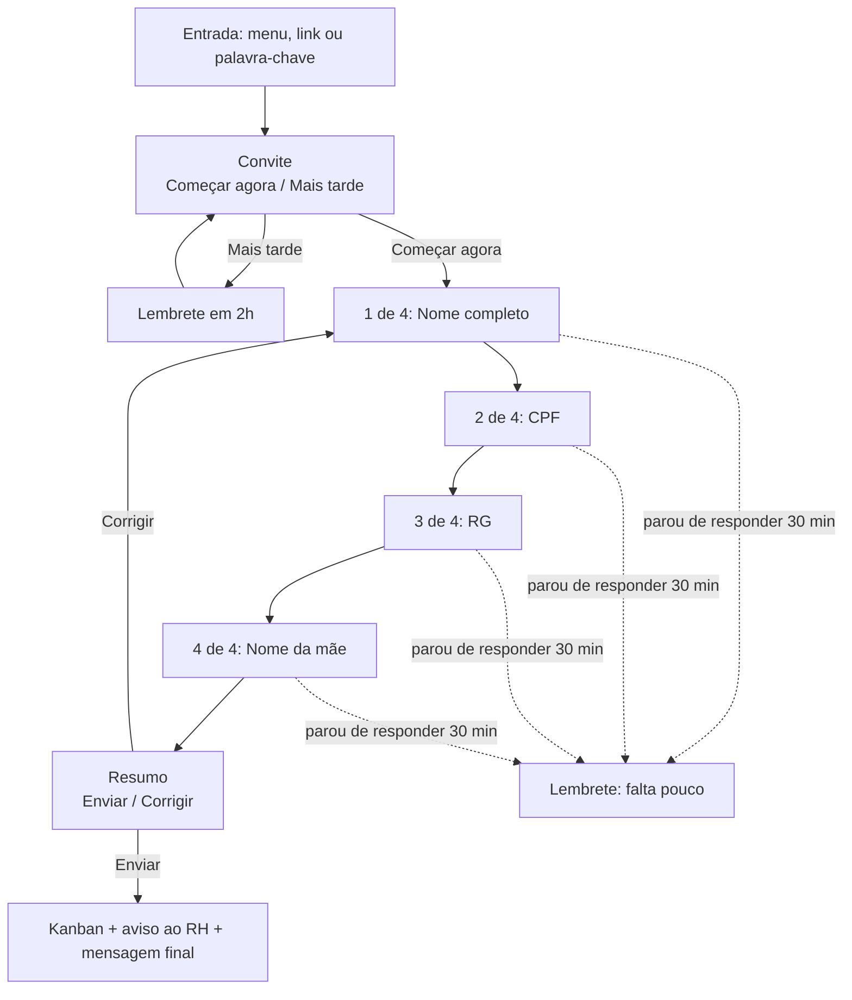

# Fluxos BotConversa – Perboni FLV

## Fluxo "Trabalhe conosco" (foco em conversão)

**Promessa do fluxo:** *4 perguntas, menos de 1 minuto, direto pelo WhatsApp.*
Essa ideia aparece no convite, em todas as perguntas ("1 de 4", "2 de 4"...)
e na mensagem final. Quem sabe que falta pouco termina o cadastro.



---

### Mensagens (copiar e colar)

> Botões do WhatsApp aceitam até 20 caracteres. Todos abaixo cabem.

**Convite**
```
Que bom que você quer trabalhar na Perboni! 🍊

Se candidatar é rapidinho:
✅ só 4 perguntas
✅ menos de 1 minuto
✅ tudo por aqui mesmo, sem currículo

Bora?
```
Botões: `[ Começar agora ]` `[ Mais tarde ]`

**1 de 4 – Nome**
```
Pergunta 1 de 4 📝
Qual é o seu nome completo?

Ex.: Maria Aparecida da Silva
```

**2 de 4 – CPF**
```
Pergunta 2 de 4 👍
Qual é o seu CPF?

Pode mandar só os números. Ex.: 12345678900
```

**3 de 4 – RG**
```
Pergunta 3 de 4 – já tá quase!
Qual é o número do seu RG?
```

**4 de 4 – Nome da mãe**
```
Última pergunta! 🙌
Qual é o nome completo da sua mãe?
```

**Resumo**
```
Prontinho, só confere:

👤 {nome_completo}
🪪 CPF: {cpf}
🪪 RG: {rg}
👩 Mãe: {nome_mae}
```
Botões: `[ ✅ Enviar ]` `[ ✏️ Corrigir ]`
("Corrigir" volta à pergunta 1. Use o texto: "Sem problema! Vamos de novo, é rapidinho 😉")

**Mensagem final**
```
Candidatura enviada! 🎉

Seus dados já estão com o RH da Perboni.
Se o seu perfil seguir no processo, a gente chama você por aqui
mesmo, então fique de olho no WhatsApp 📲

Conhece alguém que também quer trabalhar com a gente?
É só mandar este link: {link_candidatura}
```

---

### Recuperação de quem parou (é o que mais aumenta a conversão)

| Situação | Quando | Mensagem |
|---|---|---|
| Clicou em "Mais tarde" | 2 horas depois | "Oi! Sua vaga na Perboni ainda pode ser sua 🍊 São só 4 perguntas, menos de 1 minuto." + `[ Começar agora ]` |
| Parou no meio | 30 min sem resposta | "Falta pouco! Você parou na pergunta {n} de 4. Vamos terminar? 😉" + `[ Continuar ]` |
| Continuou parado | 1 dia depois (último lembrete) | "Ainda dá tempo de concluir sua candidatura. Leva menos de 1 minuto 👇" + `[ Continuar ]` |

No BotConversa: use o bloco de **espera/tempo limite** da pergunta. Mande no máximo 2 lembretes para não incomodar.
Obs.: o WhatsApp só deixa enviar mensagem livre até 24h depois da última mensagem da pessoa.

---

### Entradas diretas (menos cliques até a 1ª pergunta)

- **Link para divulgar a vaga** (Instagram, status, cartaz, grupos):
  `https://wa.me/55DDDNUMERO?text=Quero%20trabalhar%20na%20Perboni`
- **Palavra-chave**: configure no BotConversa para que mensagens com "trabalhar", "vaga", "emprego" ou "currículo" abram este fluxo direto, sem passar pelo menu.
- **Menu**: o item fica como `🤝 Trabalhe conosco – 1 min`.

---

### Quando a IA entra

Só quando a resposta não serve (CPF sem 11 números, nome sem sobrenome,
foto, áudio, pergunta no meio). Em cada pergunta, ligue a saída
"resposta inválida" ao bloco de IA. A IA ajuda com leveza, lembra que falta
pouco e devolve para a próxima pergunta.

---

### Kanban "Recrutamento" – 4 colunas

| Novo candidato | Em análise | Aprovado | Não aprovado |
|---|---|---|---|
| o bot coloca aqui | o RH arrasta ao mandar para análise | o RH arrasta | o RH arrasta |

---

### Medir a conversão (2 etiquetas)

- `cand_iniciou`: aplicada no clique em "Começar agora"
- `candidato`: aplicada no "Enviar"

**Conversão = candidato ÷ cand_iniciou.** Se ficar abaixo de ~70%, olhe em qual pergunta as pessoas param.

---

### Checklist de montagem

- [ ] 4 campos de texto: `nome_completo`, `cpf`, `rg`, `nome_mae`
- [ ] 2 etiquetas: `cand_iniciou`, `candidato`
- [ ] Kanban "Recrutamento" com 4 colunas
- [ ] Fluxo com as mensagens acima
- [ ] Lembretes (Mais tarde / parou no meio)
- [ ] Palavras-chave e link wa.me apontando para o fluxo
- [ ] Ação final: Kanban "Novo candidato" + notificar Sandra
- [ ] CPF e RG visíveis só para o RH

---

## Menu principal – lista

```
Olá 👋 Eu sou a Ana, da Perboni FLV. Como posso ajudar?
[ Ver opções ]
```
📦 Atacado · 🎁 Cestas · 💳 Financeiro · 🚚 Ser fornecedor ·
🤝 Trabalhe conosco – 1 min · 💡 Sugestões · 👤 Falar com atendente

Atacado → Wagna/Gil · Financeiro → Mira · Fornecedor → Ricardo ·
Cestas → a IA apresenta as cestas · Atendente → transfere para humano.
